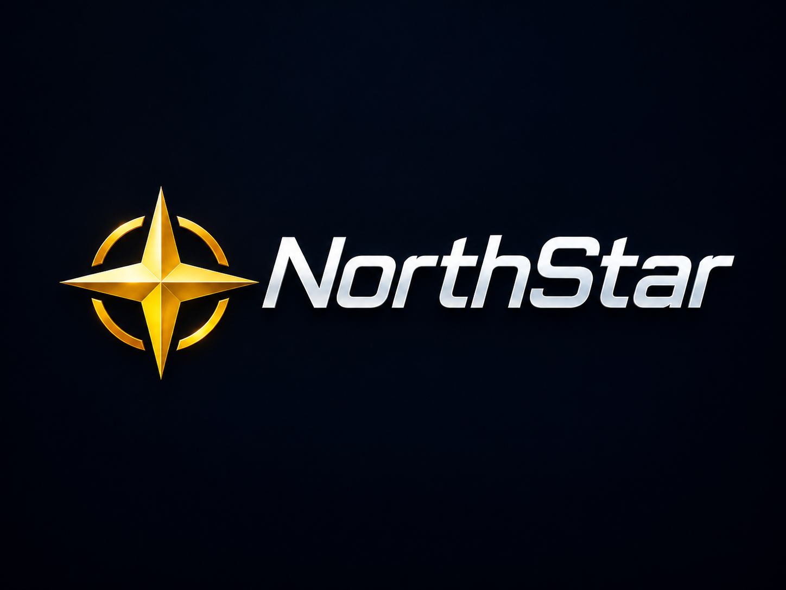

  

<h1 align="center">NorthStarCpp</h1>

<strong>A modular C++ game engine, built to evolve.</strong>

Native tools · Replaceable engine capabilities · Extensible runtime · Open-world foundations

  
  
  
  
  
  

  <a href="#getting-started">Getting started</a> ·
  <a href="#engine-systems">Engine systems</a> ·
  <a href="#architecture">Architecture</a> ·
  <a href="#documentation">Documentation</a> ·
  <a href="https://github.com/Take-Some/NorthStarCpp">Repository</a>

---

## Overview

**NorthStarCpp** is a native **C++17 game engine and development toolkit** focused on clear subsystem boundaries, an extensible capability ABI, and useful tools for building interactive 3D projects.

Instead of binding the runtime to a single backend, NorthStarCpp resolves capabilities by stable `engine.*` interfaces. Implementations can be linked into the engine as **builtin providers** or delivered as replaceable **external DLL/SO plugins**. The editor, player, SDK, asset pipeline, and test tools share this architecture.

> **Development status:** NorthStarCpp is an actively developed engine, **not a production-certified Unreal Engine alternative**. Individual subsystems and targeted regression tests work; complete release acceptance, advanced rendering, and large-world workflows are still evolving. See the [current engineering status](docs/CURRENT_STATUS.md).

## Highlights

<table>
<tr>
<td width="50%" valign="top">
<h3>Modular by design</h3>

Versioned native capability interfaces, provider selection, and ABI validation. External plugins can override compatible builtin capabilities without changing game-facing APIs.

</td>
<td width="50%" valign="top">
<h3>Native development tools</h3>

A <strong>Qt 6 Project Manager</strong>, a <strong>Qt Editor</strong>, and a dedicated <strong>Asset Browser</strong> for scenes, projects, resources, and authoring workflows.

</td>
</tr>
<tr>
<td valign="top">
<h3>Assets and streaming</h3>

Virtual file system, shared/project assets, asynchronous resource requests, cache management, and NEF8-based scene and resource workflows.

</td>
<td valign="top">
<h3>World foundations</h3>

Versioned binary scenes, prefabs, spatial streaming support, ECS integration, and world-partition-oriented tooling under active development.

</td>
</tr>
<tr>
<td valign="top">
<h3>Game runtime</h3>

Physics, input, audio, scripting integration, save-game support, and a standalone native player.

</td>
<td valign="top">
<h3>Engineering workflow</h3>

GCC/MinGW-w64, CMake, Ninja, CTest, reproducible tooling, module manifests, and release/package validation.

</td>
</tr>
</table>

## Getting started

### Requirements

The primary Windows development environment uses:

- **Windows x64** with **GNU GCC / MinGW-w64** (MSYS2 is supported).
- **CMake 3.21+** and **Ninja**.
- **Qt 6 Widgets** built for the **same MinGW toolchain** as the engine.
- **Python** for development commands, checks, and packaging tools; the project manager itself is native C++/Qt.
- **Git** with submodule support.

Selected features require additional third-party libraries or SDKs. In particular, native V8 scripting requires a compatible, separately configured **V8 SDK**.

### Clone

~~~powershell
git clone --recurse-submodules https://github.com/Take-Some/NorthStarCpp.git
cd NorthStarCpp
~~~

If the repository has already been cloned:

~~~powershell
git submodule update --init --recursive
~~~

### Build and run

Launch the native project browser using `northstarcpp.cmd` without arguments, or use the CLI:

~~~powershell
.\northstarcpp.cmd doctor
.\northstarcpp.cmd configure
.\northstarcpp.cmd build
.\northstarcpp.cmd test
.\northstarcpp.cmd editor
.\northstarcpp.cmd run --target player
~~~

The editor and player require a successfully configured build and their relevant runtime modules. For toolchain setup and launch details, follow the [quick start](docs/START_HERE.md) and [GNU GCC guide](docs/GCC_DEVELOPMENT_SHELL.md).

## Engine systems

| Area | Current implementation / direction |
| :--- | :--- |
| **Capability API** | Versioned `engine.*` contracts; builtin and external providers; ABI-aware resolution and overrides |
| **Entity Component System** | Flecs-based ECS provider; persistent scene/entity integration |
| **Physics** | Bullet and Jolt providers, with a common physics interface |
| **Rendering** | Direct3D 11 and Direct3D 12 providers; broader GPU viewport and rendering features remain in development |
| **Assets** | Directory/VFS provider, NEF8 resources, YDD models, YTD textures, YMAT materials, and asynchronous loading |
| **World & scenes** | Binary `.nscn` scenes, prefabs, scene streaming and world-partition foundations |
| **Scripting** | Replaceable scripting API with optional V8 integration and script-service extensions |
| **Input & audio** | Win32/XInput controls and native audio-provider infrastructure |
| **Diagnostics** | Multi-sink logger, crash diagnostics, smoke tests and QA tooling |

For capability IDs, selection rules, contracts, and runtime examples, see [Module Loading](docs/MODULES.md). Capabilities are at different stages of implementation; listing a system here does not imply complete feature parity or release certification.

## Development applications

| Tool | Purpose |
| :--- | :--- |
| **Project Manager** | Discover, create, inspect, import, and launch projects |
| **Qt Editor** | Scene hierarchy, object editing, viewport, and authoring workflows |
| **Asset Browser** | Browse models, textures, materials, and virtual dictionary resources |
| **Player** | Launch and validate project scenes in the native runtime |
| **Shader Generator** | Shader-related development utilities |

The active editor is the **Qt-based editor**. GPU viewport functionality and full ECS component editing are in progress; Play-In-Editor, advanced world tools, and full visual parity are not yet complete.

See [Qt Project Browser](docs/PROJECT_BROWSER_QT.md), [Content Browser](docs/QT_CONTENT_BROWSER.md), and [Editor progress](docs/EDITOR_GPU_VIEWPORT_ECS_COMPONENTS_2026-11-14.md).

## Architecture

NorthStarCpp keeps **public contracts**, **engine implementations**, **third-party dependencies**, and **build outputs** distinct.

~~~text
NorthStarCpp/
├── .github/                  Project branding
├── architecture/             Module ownership and architecture catalog
├── sdk/
│   ├── include/northstarcpp/ Public APIs and plugin ABI
│   └── vendor/               Third-party dependencies and SDKs
├── engine/northstarcpp/
│   ├── modules/              Engine and provider implementations
│   └── resources/            Native application resources
├── Projects/                 Example and test projects
├── sharedAssets/             Shared runtime assets
├── tools/                    Development, QA, and packaging utilities
├── tests/                    Unit and integration regression tests
├── docs/                     Technical documentation
├── config/                   Configuration templates
├── out/                      Generated builds (ignored by Git)
└── dist/                     Packaged releases (ignored by Git)
~~~

### One API, multiple providers

~~~text
Editor / Player / Project
           │
           ▼
     engine.* API
           │
           ▼
     Capability loader
       ┌───┴────┐
       ▼        ▼
    Builtin   External
    provider  DLL / SO
~~~

A compatible external provider can take precedence over a builtin implementation through the documented discovery and override rules. Not every planned `engine.*` capability has completed provider-substitution testing yet.

Read [Repository Architecture](docs/ARCHITECTURE.md), [Engine Layout](docs/ENGINE_LAYOUT.md), and [Module Loading](docs/MODULES.md) for the authoritative design.

## Testing and distribution

Run the test suite after configuring and building:

~~~powershell
.\northstarcpp.cmd test
~~~

A clean release build and packaging workflow is available through:

~~~powershell
.\tools\build_release.cmd
~~~

Release packaging includes module and dependency checks, but **a successful local build is not proof of certified production readiness**. Consult the [distribution guide](docs/DISTRIBUTION.md) and [current status](docs/CURRENT_STATUS.md) and [release execution plan](docs/NORTHSTARCPP_1_0_EXECUTION_PLAN_2026-11-18.md) before shipping.

## Documentation

| Guide | Topics |
| :--- | :--- |
| [Documentation Index](docs/INDEX.md) | All maintained references and historical reports |
| [Current Status](docs/CURRENT_STATUS.md) | Latest documented engineering results and open production gates |
| [Documentation Policy](docs/DOC_POLICY.md) | One owner per fact, evidence, formatting and historical QA rules |
| [Quick Start](docs/START_HERE.md) | First launch, commands, and project setup |
| [Architecture](docs/ARCHITECTURE.md) | Repository boundaries and dependency direction |
| [Modules & Plugins](docs/MODULES.md) | ABI contracts, builtin providers, and runtime overrides |
| [Qt Project Browser](docs/PROJECT_BROWSER_QT.md) | Project discovery, Qt, and launch workflow |
| [Qt Content Browser](docs/QT_CONTENT_BROWSER.md) | Asset browsing and preview |
| [Scenes & Streaming](docs/SCENE_V3_STREAMING.md) | Scene format and streaming model |
| [Prefabs](docs/PREFABS.md) | Prefab creation and instantiation |
| [Scripting](docs/SCRIPTING_API.md) | JavaScript/V8 contracts and scripting API |
| [Distribution](docs/DISTRIBUTION.md) | Release builder and packaging checks |
| [Historical Readiness Audit (Nov 14)](docs/FULL_ENGINE_READINESS_AUDIT_2026-11-14.md) | Prior point-in-time snapshot; see Current Status above |

## Contributing and legal notes

NorthStarCpp is under active architectural development. Before making changes, review the [architecture contracts](docs/ARCHITECTURE.md), keep module ownership explicit, preserve public ABI compatibility when required, and add relevant tests.

The repository contains adapted historical sources and third-party dependencies. **Preserve original copyright notices, attribution, and applicable third-party licenses.** Public availability of a source tree does not by itself grant rights to redistribute separately licensed dependencies or external game assets.

Project root license: [GNU GPL v3](LICENSE). See [Authorship & Licenses](docs/AUTHORSHIP.md) for additional information.

---

<strong>NorthStarCpp</strong> · Engine &amp; tools by <strong>Kayla's Systems</strong>

<em>Developed and maintained by Kayla Verner · 2026</em>

<a href="#northstarcpp">Back to top</a>

